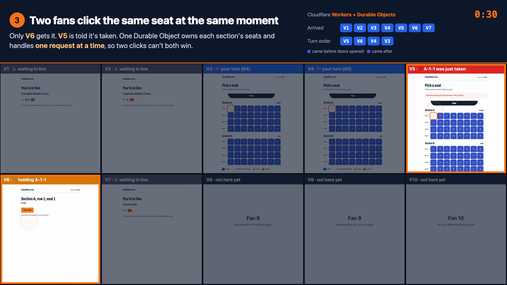

# Concert booking on Durable Objects

A prototype ticket sale for one concert, built on Cloudflare Workers and
Durable Objects. People join a line, the line is shuffled when the doors open,
each person gets a few minutes on the seat map, and a seat can only be sold
once.

Live: https://concert-booking.saahitya-e.workers.dev

[](docs/concert-demo.mp4)

The [demo video](docs/concert-demo.mp4) shows ten browsers going through a sale.

## How it works

There are three Durable Object classes:

- `QueueRoom`, one per event, is the line. It shuffles everyone who is waiting
  when the doors open, then an alarm admits a few people at a time and gives
  each one a signed admission token. Waiting browsers get their place in line
  over a WebSocket.
- `SeatShard`, one per section, owns that section's seats. Holding, paying for
  and releasing a seat each happen in one step. An alarm releases holds that
  run out.
- `UserHold`, one per person, limits how many seats one person can hold at
  once across sections.

A Durable Object handles one request at a time, so checking that a seat is free
and holding it can't interleave with someone else doing the same. That is what
stops a seat being sold twice.

The Worker (`workers/app.ts`) is a React Router app. It renders the pages and
sends each API call to the right object (`workers/lib/booking.ts`).

## Run it

```bash
npm install
cp .dev.vars.example .dev.vars
npm run dev
```

## Test

```bash
npx playwright install chromium
npm run test:e2e
```

The tests start their own dev server with short timers and use a new event
each. They cover many people trying for the same seat, the hold limit, holds
running out, the order of the line, and the main flow in a browser.

## Demo video

```bash
npm run demo:video
```

Needs ffmpeg. Writes `demo/concert-demo.mp4`. The script is
`scripts/record-demo.mjs`.

## Deploy

```bash
npx wrangler secret put ADMISSION_TOKEN_SECRET
npm run deploy
```

## Limitations

- People are identified by a random id stored in the browser. There are no
  accounts.
- You can't release a hold, and checkout handles one seat at a time.
- Anyone can start a sale at `/event/<any-id>`, and sales are never cleaned up.

## Dependencies

`.npmrc` stops npm installing package versions published in the last 7 days.
`npm run check:deps` checks the versions already in `package-lock.json`.

## License

MIT
