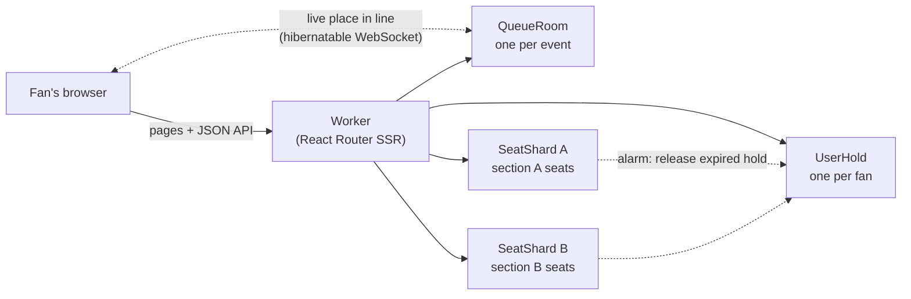

# Fair Concert Booking on Cloudflare Workers + Durable Objects

[](https://concert-booking.saahitya-e.workers.dev)
[](LICENSE)

A ticket sale built for the moment a crowd arrives at once. Fans wait in a
virtual waiting room, get a random place in line when the doors open, take
turns on the seat map, and can never be sold the same seat. It's a working
answer to *"can you build large-scale concert ticketing on Durable Objects?"*,
small enough to read in an afternoon.

**[▶ Watch the 2-minute demo](docs/concert-demo.mp4)**: ten fans in ten
separate browsers, narrated one step at a time.

[](docs/concert-demo.mp4)

**[Try it live →](https://concert-booking.saahitya-e.workers.dev)** Click
*Start a sale*, then open the link in a few private windows. Each window
is a different fan, and the doors open 20 seconds after the first one arrives.

## What it guarantees

| Promise | How |
|---|---|
| **No seat is sold twice** | Each section's seats live in one `SeatShard` Durable Object. A Durable Object handles one request at a time, so "is it free? then it's mine" can't interleave with anyone else's. |
| **Arriving early doesn't help** | Everyone waiting when the doors open gets a random lottery number. Anyone who arrives later queues behind them in arrival order. |
| **The crowd doesn't hit the seat map all at once** | An alarm on the `QueueRoom` admits a few fans per tick, each with a signed admission token that the seat API checks. |
| **Nobody hoards** | A `UserHold` object per fan caps how many seats they can hold at once, across every section. |
| **Abandoned seats come back** | Holds expire. An alarm on the `SeatShard` puts expired seats back on sale and frees the fan's slot. |

All of it is covered by the [end-to-end tests](#tests), including 24 fans racing
for one seat, 40 fans rushing a 16-seat block, and the hold limit under
parallel requests.

## How it works



A Durable Object is a single-threaded mini-server with its own SQLite storage,
addressed by name. Picking the right "unit of consistency" for each object is
the whole design:

- **`QueueRoom`** (`workers/durable-objects/queue-room.ts`): one per event.
  Stores who's waiting, draws the random order at doors-open, and runs an alarm
  every tick that admits the next fans and mints their admission tokens. Each
  tick it pushes everyone's new place in line over hibernatable WebSockets,
  ranking the whole queue in a single SQL query.
- **`SeatShard`** (`workers/durable-objects/seat-shard.ts`): one per (event,
  section). Owns that section's seats; hold, confirm and release are each a
  single atomic step. An alarm set for the earliest hold expiry sweeps expired
  holds back to available.
- **`UserHold`** (`workers/durable-objects/user-hold.ts`): one per (event,
  fan). Shards don't know about each other, so the cross-section "at most 3
  holds" rule needs its own coordination point. Every hold reserves a slot here
  first.

The Worker (`workers/app.ts`) is a stateless React Router app: it renders the
pages and routes each API call to the right object
(`workers/lib/booking.ts`).

### Scaling it up

This demo has one event with two sections of 32 seats. For a real stadium:

- **Seats:** shard by section (or by block within a section). Each shard is
  independent, so throughput grows with the number of shards. Only the
  per-fan hold limit crosses shards.
- **Queue:** a single `QueueRoom` serializes joins and polls for one event.
  For very large crowds you'd split arrivals across several queue objects and
  merge them by lottery number at admission time. The per-tick broadcast is
  already one ranking query, not a query per fan.
- **Admission rate:** set it to what checkout can handle (`QUEUE_BATCH_SIZE` /
  `QUEUE_TICK_MS` in `workers/lib/config.ts`). That's what keeps the seat map
  and payment from seeing the whole crowd at once.

## Running locally

```bash
npm install
cp .dev.vars.example .dev.vars   # sets ADMISSION_TOKEN_SECRET for local dev
npm run dev                      # http://localhost:5173
```

## Tests

```bash
npx playwright install chromium  # once
npm run test:e2e                 # ~35s
```

The suite starts its own dev server (port 5288) with shortened timers (doors
open after 3s, admissions last 12s, holds 6s) and gives every test a fresh
event:

- `e2e/booking-invariants.spec.ts`: no double-booking under races and
  stampedes, the hold limit (including parallel requests), hold expiry, forged
  and stolen admission tokens, and no user ids in public responses.
- `e2e/queue-fairness.spec.ts`: the pre-open crowd is shuffled, latecomers go in
  arrival order, and expired admissions are re-queued.
- `e2e/journey.spec.ts`: the full browser journey, two fans seeing each other's
  picks, refresh and Back, and a regression test for a redirect loop between
  the waiting room and the seat map.

## Demo video

```bash
npm run demo:video   # writes demo/concert-demo.mp4 (needs ffmpeg)
```

`scripts/record-demo.mjs` drives ten browsers through a scripted sale and
stitches their recordings under a caption band. Roles are assigned by turn
order (the draw is random), so every take shows the same story with a
different shuffle.

## Deploying

```bash
npx wrangler secret put ADMISSION_TOKEN_SECRET   # once: any long random string
npm run deploy
```

## Project layout

```
app/routes/            pages (waiting room, seat map, checkout) and the JSON API
workers/app.ts         Worker entry: React Router request handler + DO exports
workers/durable-objects/
  queue-room.ts        waiting room, lottery, admission ticks, live updates
  seat-shard.ts        seat inventory and atomic holds for one section
  user-hold.ts         per-fan hold limit across sections
workers/lib/           booking orchestration, admission tokens, config
e2e/                   Playwright end-to-end tests
scripts/               demo recorder, dependency-age check
```

## Known limitations

It's a demo, and these are deliberate shortcuts:

- **Identity is a random id the browser keeps in `localStorage`.** It's never
  shown to other fans, but there are no accounts, and someone who learns your id
  can act as you. A signed, server-set cookie is the next step.
- **No way to release a hold from the UI**, and checkout takes one seat at a
  time.
- Holds (4 minutes) can outlast a turn on the seat map (3 minutes).
- Anyone can create a new sale by visiting `/event/<any-id>`, and sales are
  never cleaned up.

## Supply-chain rule

`.npmrc` sets `min-release-age=7`, so npm never installs a package version
published in the last 7 days. `npm run check:deps` checks every version already
in `package-lock.json` too.

## License

[MIT](LICENSE)
